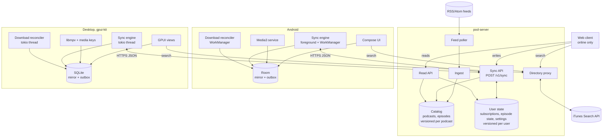
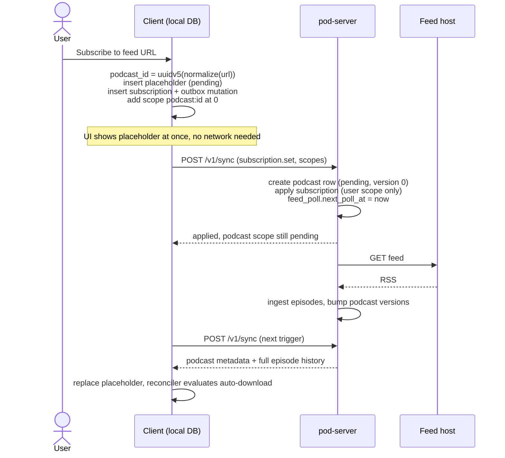

# Pod v2 design

Status: draft, 2026-10-25. Reflects the server implementation on branch `v2` of the pod repo.
Companion: [spec.md](spec.md) has the wire protocol, schemas and state machines.

## Why rewrite

Pod today is a Rust server (`pod/crates/pod-server`), a Rust TUI (`pod/crates/pod-tui`), a single-file web UI (`pod/frontend/index.html`) and an Android app (`pod-android`). It works, and most of its features landed in a few weeks. Offline support arrived late and in pieces. The server first got a delta feed for episodes, then a timestamp-based progress feed, then each client grew its own download code. Every client now treats offline as a cache in front of an online app.

That shows up in the details. Progress written while offline never reaches the server on Android, because `AppViewModel.reportProgress` and `markEpisodeDone` fire a single HTTP call and log the failure. The TUI keeps a `dirty` flag, but its sync pulls server progress before pushing local progress (`pod-tui/src/sync.rs`, steps 3 and 4), so a newer edit from another device silently replaces the offline one. Downloads on Android went through three rounds of review fixes and still list open races in `pod-android/SESSION.md`.

The goal of v2 is to cover the same features with offline sync and downloads as the starting assumption. The client reads and writes only its local database. Network sync is a background process that converges that database with the server. Downloads are a second background process that converges files on disk with what the user wants available offline.

## What the current system does

This is the feature list v2 has to cover. Everything here exists in at least one client today.

Accounts and sessions. Username and password registration (can be disabled with `ALLOW_REGISTRATION`), Argon2 hashes, 30-day bearer tokens, multiple sessions per user, logout.

Catalog. Subscribe by RSS or Atom feed URL. The server polls every feed on a fixed interval (`REFRESH_INTERVAL_SECS`, default 600 s) with `If-None-Match` and `If-Modified-Since`, and stores new episodes with title, summary, `content:encoded`, publication date, enclosure URL, MIME type, duration and thumbnail. Only audio enclosures count (`feed.rs`, `is_audio_mime`).

Discovery. All three clients search the public iTunes Search API directly from the device and send the chosen feed URL to `POST /api/v1/podcasts`.

Listening state. Per user and episode, a position in seconds and a `done` flag. Replaying a done episode resets it. Reaching the end marks it done.

Views. Podcast list sorted by latest episode. Episode list per podcast, paginated. Episode detail with rendered HTML show notes. Inbox, meaning unplayed episodes across all subscriptions (Android limits it to the last 30 days, the server and TUI do not).

Playback. Android uses Media3 with a foreground `MediaSessionService`, a mini player, a full player sheet, playback speed, a configurable skip interval, a sleep timer and restore-on-cold-start. The TUI drives `mpv` over IPC and exposes MPRIS media keys. The web UI plays in an `<audio>` element.

Offline. Android caches podcasts and episodes in Room and pre-warms artwork in Coil's disk cache. The TUI caches in SQLite. Both download audio on request, and playback prefers the local file. Android also marks podcasts as favorites, which runs an hourly WorkManager job that notifies about new favorite episodes and auto-downloads the newest three per favorite.

Missing everywhere. Unsubscribe, a playback queue, storage limits or cleanup of played downloads, OPML import and export, and any server-side handling of episodes that change or disappear from a feed.

## Problems worth designing out

Some of these are bugs in the current code, others are structural. I verified each against the source.

1. **The change log can skip episodes.** `insert_episode` takes a `BIGSERIAL` value inside its own transaction, and `refresh_all_podcasts` runs one refresh per feed concurrently in a `JoinSet`. Postgres hands out sequence values at insert time, not commit time. If the transaction holding seq 10 commits after the one holding seq 11, a client that synced in between stores cursor 11 and never sees seq 10. The progress feed has the same hole, since it filters on `last_updated > since` and `last_updated` is the transaction start time.
2. **Episode ids collide across podcasts.** The episode primary key is the raw feed GUID (`feed.rs`, `id: entry.id.clone()`). Two feeds that use GUIDs like `1`, `2`, `3` collide. `insert_episode` then turns the insert into a no-op through `ON CONFLICT (id) DO UPDATE SET id = EXCLUDED.id`, yet still writes a change-log row, and `find_new_episode_ids` reports the episode as new on every refresh.
3. **Newly subscribed podcasts fall outside the cursor.** A single global cursor cannot express "give me the full history of a podcast I just subscribed to". Android works around it by diffing podcast ids before each sync (`SyncManager.sync`). The TUI does not, so a podcast added on another device shows up empty in the TUI until it re-bootstraps.
4. **Writes are online-only.** Subscribing needs the server to fetch the feed first, because the podcast id comes from the feed. Progress and done state are fire-and-forget on Android and web.
5. **Two sync mechanisms with different rules.** Episodes use a seq cursor, progress uses a server timestamp, the podcast list is refetched in full. Each needed its own bootstrap and its own bugs.
6. **Catalog updates and removals are ignored.** Refresh only inserts unknown GUIDs. A publisher fixing a title or replacing an enclosure URL never reaches clients. The protocol describes tombstones, but the server never emits them and never returns `410`.
7. **Downloads are tracked as a status string next to a file.** Android has `downloading`, `completed`, `failed`. A transient failure that WorkManager will retry looks like a stalled transfer. Logout can leave an orphaned row. Nothing ever deletes played audio.
8. **Several feed-parsing panics.** `add_podcast` calls `unwrap()` on the feed title and `expect()` on the image. `entry_to_episode` unwraps the entry title and calls `expect()` on the enclosure URL and MIME type. One malformed feed fails the subscribe request with a panic instead of an error.

## Design principles

**Local first.** Every client action is a write to the local database and returns at once. The UI renders from local queries only. No screen waits on the network, except search and the first login.

**Two kinds of data, two sync rules.** The catalog (podcasts, episodes) comes from feeds, the server owns it, and clients only read it. User state (subscriptions, listening state, settings) belongs to the user and any device may write it. The catalog syncs one way with versioned rows. User state syncs both ways through an outbox of idempotent mutations.

**Version numbers under a lock, not sequences.** Every syncable row carries a `version` drawn from a counter that lives on its scope row (the podcast for catalog rows, the user for user state). Bumping the counter takes a row lock, so writers within one scope serialize and commit in version order. That removes problem 1 without global locks, since different podcasts and users still write in parallel.

**Cursors per scope.** The client keeps one cursor for its user scope and one per subscribed podcast. A new subscription starts at cursor 0, which yields that podcast's full history through the same code path as an incremental sync. Bootstrap, new subscriptions and catch-up are all one loop. No head endpoint, no snapshot phase.

**Deterministic ids.** Podcast id is a UUIDv5 of the normalized feed URL. Episode id is a UUIDv5 of podcast id plus feed GUID (or enclosure URL if the GUID is missing). Clients compute the podcast id offline, so subscribing works without network, and ingestion is idempotent by construction.

**Desired state for downloads.** Clients don't start downloads. They record why an episode should be on disk (pinned by the user, or chosen by an auto-download rule). A reconciler compares that against the files on disk and downloads, retries or evicts until they match. A crash, a logout or a revoked network all leave the system in a state the next reconciler pass can fix.

## Architecture

### Server

One Rust binary with three parts that share a Postgres pool.

The feed poller keeps a fixed interval (15 minutes by default) but tracks it per feed (`next_poll_at`). That lets it back off feeds that keep failing, stop polling feeds nobody subscribes to, and poll a feed right away when someone subscribes. It honours `ETag`, `Last-Modified` and `Retry-After`. Adapting the interval to each feed's publishing rhythm isn't worth it for a few hundred feeds.

Ingest parses a fetched feed into a normalized form and diffs it against stored episodes by a content hash. New and changed episodes get upserted with a fresh version. Episodes that drop out of a feed stay, because feeds truncate old items and that isn't a deletion. A feed returning `410 Gone` marks the podcast as gone and stops polling, but its episodes stay. Only an admin purge writes an episode tombstone, and the purge sticks until the publisher changes that episode. Feed URLs are untrusted input. Every fetch and redirect goes through a guard that refuses internal addresses, and show notes are sanitized against a small HTML allowlist before they're stored (spec 2.2, 3.2).

Catalog rows are shared between users, so each feed is polled and stored once however many people subscribe. Sharing has no visible effect across accounts. A podcast scope is only served to its subscribers, episodes carry no user data, and listening state lives in user scope. Private feeds (Patreon, Supercast and the like) put a per-listener token in the URL. That token is part of the normalized URL, so each listener gets their own podcast id, their own poll and their own episodes. One subscriber's token never serves another subscriber's feed.

The API serves auth, the sync endpoints, read endpoints for the web client, and a directory search proxy over iTunes. The proxy gives all three clients one search implementation and lets the server cache results. It needs a login, so the server isn't an open proxy.

A self-hosted server has no admin UI. A daily job in the same process deletes expired sessions and old mutation receipts. For everything else there is `pod-server admin`, a subcommand that runs one command against the configured database and exits: `list-users`, `purge-episode` and `reset-password` (spec section 12).

### Clients

Android and a new desktop app share one client architecture. Each implements it natively. The desktop app replaces the TUI. It's a native GPUI application built on gpui-kit (section "Desktop client").

The local store holds the catalog mirror, user state, the outbox, sync cursors and download state. It is the only thing the UI reads.

The sync engine pushes the outbox, then pulls changes for every scope, applying each page in one local transaction together with the cursor update. It runs on app start, on a timer while in the foreground, on connectivity regain, after any local write (debounced), and from a periodic background job on Android.

The download reconciler is described above. On Android it is a WorkManager job, on desktop a task on the app's tokio runtime. It uses HTTP range requests, so an interrupted transfer resumes instead of restarting.

The player reads and writes listening state through the local store. It never talks to the network except to stream audio that isn't on disk.

The web client stays online-only. It uses the same mutation endpoint for writes and the read endpoints for lists, so the server has one write path. Making it offline-capable (IndexedDB plus a service worker) would be possible with the same protocol, and I'd leave it out until someone needs it.

### Desktop client

The desktop app is a Rust binary on `gpui-kit`, which bundles GPUI (Zed's UI framework), `gpui-component` widgets and default assets behind one dependency. Linux comes first, then macOS. Being Rust, it shares the `pod-protocol` crate with the server. Wire types, id derivation, the merge function and the conformance runner then exist once in Rust and once in Kotlin, not three times.

GPUI runs its own executors, while `reqwest` and the download code expect tokio. The app therefore starts one tokio runtime on a background thread for the sync engine, the reconciler and HTTP. The UI thread never touches the network. SQLite (`rusqlite`, WAL mode) is the meeting point. The background side writes, and after each committed transaction the store sends a "tables changed" event over a channel. GPUI entities subscribed to those tables re-run their queries and call `cx.notify()`. That stands in for the observable queries Room gives Android for free, and it's the one piece of plumbing the desktop app needs that Android doesn't.

Playback uses `libmpv` (through the `libmpv2` crate) in audio-only mode. v1 already depends on mpv, and it handles streaming, seeking, every enclosure format and pitch-corrected speed. Pure-Rust stacks (`rodio`, `symphonia`) would need extra work on HTTP seeking and time-stretching. Media keys and the OS now-playing widget go through `souvlaki`, which covers MPRIS, macOS and Windows behind one API. `libmpv` is a system dependency, provided by the Nix flake.

The desktop app has no background job. Sync and downloads run while a window is open, plus at startup to catch up. Closing to a tray icon to keep auto-downloads running would be a later addition.

UI tests use gpui-kit's `test-support` feature, which renders real views in headless windows, simulates input and reads accessibility snapshots.

### Why not a shared Rust client core

The desktop app's sync engine and reconciler are Rust. I considered binding that same code into Android through UniFFI. It doesn't pay for itself here. My guess is the sync loop comes to a few hundred lines per platform once the protocol is fixed. The download half is mostly platform glue (WorkManager constraints, foreground notifications, scoped storage) that a shared core can't own. And Room's observable queries, which drive Compose, would have to be rebuilt on top of a Rust-owned SQLite file. A shared conformance test suite (fixtures of server responses and expected local state) gets most of the consistency benefit for a fraction of the cost. See spec section "Conformance fixtures".

## Conflict resolution

The catalog has no conflicts. The server is the only writer.

User state uses last-writer-wins per field. Each mutation carries the device's wall-clock time of the user action (`at`). Each field (`position`, `played`, subscription membership, each setting) stores its own `at`. The server applies a mutation only if its `at` is newer than the stored one for that field, with the device id as tiebreaker. Because each field has its own `at`, marking an episode played on the phone isn't undone by a stale position update the laptop sends an hour later.

I picked wall-clock LWW over hybrid logical clocks on purpose. The edits that conflict here are a single person moving between their own devices minutes or hours apart, and phone clocks are NTP-synced. The server clamps `at` to its own time plus 60 seconds and tells the device the value it stored, and the device adopts it. So a device with a clock far in the future can't win forever, on the server or locally. If skew turns out to matter in practice, replacing `at` with an HLC is a change to the clock source, not to the protocol shape.

Position and played are independent. A position update never touches `played`, so a late-arriving progress tick can't reopen a finished episode. Replaying a finished episode (which resets it, as Android does today) is an explicit `played = false` write of its own.

## Offline subscribe

The client computes the podcast id from the feed URL, inserts a local placeholder podcast (`state = pending`), adds a subscription and queues a `subscribe` mutation. The UI shows the feed URL (or the directory result's title and artwork, if the user came from search) with a "waiting for first sync" state. When the server applies the mutation it creates the podcast row if needed and schedules an immediate poll. The next pull for that podcast scope fills in the real metadata and episodes. If the feed turns out to be invalid, the server records the error on the podcast row, and the client shows it and offers to remove the subscription. A URL the server refuses outright, such as one pointing at an internal address, rejects the mutation instead, and the client removes the placeholder.

## Inbox

The inbox is a local query, the same on every client. It holds unplayed, unarchived episodes from subscribed podcasts published in the last 30 days. Episodes published before the user subscribed are left out, except the podcast's newest one. Archiving is a new per-episode flag (`archived`) next to `played`. It replaces using "mark done" to clear the inbox, which today also hides real listening history. The window length is a synced user setting.

## Downloads

Download wishes come from two sources.

- **Pin.** The user tapped download. Stays until the user removes it or finishes the episode.
- **Auto rule.** A per-podcast, per-device rule like "keep the newest 3 unplayed episodes". The reconciler re-evaluates rules after every sync.

The reconciler fits the wishes into the storage budget before downloading anything. Pins always count. Auto wishes are added newest first until the budget is full, and the rest are shown as skipped. It downloads what's missing from that target and evicts files outside it after a grace period. It never evicts the file being played, though playing alone never starts a download. Because the target already fits the budget, the reconciler never downloads a file only to evict it on the next pass. Played episodes lose their auto wish, and finishing an episode releases its pin, so played files get cleaned up either way. That closes the "downloads are never reclaimed" gap without a cleanup screen. The mobile-data switch covers every download, pins included. A single pin can opt out of it with "download on mobile data anyway". Being offline or out of disk space isn't a failure. Downloads wait for a connection or for space without using up their retries, so a pin queued on a plane downloads when it lands.

Download state is device-local and never syncs. Which files a phone has is meaningless to a laptop. Auto-download rules are device-local too, since a phone on cellular and a desktop want different rules. Favorites and notifications collapse into the same per-podcast device settings.

## Playback

Playback stays a platform concern, with one shared contract. The player writes position to the local store every 5 seconds while playing and on every pause, seek, stop and episode change. Each write upserts the local listening state and coalesces into the outbox, so the outbox holds at most one pending position per episode. Reaching the end (within 30 seconds or 2%, matching current behaviour) writes `played = true`.

The Android split from the latest refactor stays. The service owns playback behaviour (sleep timer, skip interval, mark played) and the UI is a view over session extras. That split was correct, and the reason it was needed (the activity dying while playback continues) applies to sync writes too. The service writes through the local store directly and doesn't go through the view model.

Playback speed and skip interval become synced user settings. Sleep timer state stays ephemeral.

## Feature mapping

| Today | v2 |
| --- | --- |
| Username/password, bearer token | Same, plus a `device_id` per session for LWW tiebreaks |
| `POST /podcasts` (online, server fetches feed) | `subscribe` mutation, works offline, server polls on apply |
| No unsubscribe | `unsubscribe` mutation, podcast scope cursor dropped on client |
| Fixed-interval refresh of every feed (default 10 min) | Fixed interval tracked per feed, error backoff, immediate poll on subscribe, no polling without subscribers |
| Only new episodes ingested | New and changed episodes. `410` marks the podcast gone, tombstones only on admin purge |
| `/sync/head`, `/sync/changes`, `/sync/progress`, full podcast list | One `POST /v1/sync` (push and pull), per-scope cursors |
| Progress: seconds, LWW by server arrival | Milliseconds, per-field LWW by action time |
| `done` | `played` plus a separate `archived` for inbox triage |
| Inbox differs per client | One definition, local query, synced window setting |
| iTunes search on each client | `GET /v1/directory/search` proxy |
| Favorites: notify + auto-download newest 3 | Per-device podcast settings: `notify`, auto-download rule |
| Download status string, no cleanup | Wish set + reconciler, resumable, storage budget, eviction |
| Artwork precache (Android) | Reconciler step: fetch artwork for subscribed podcasts and inbox episodes |
| Speed, skip interval device-local | Synced user settings |
| TUI (ratatui, mpv over IPC, MPRIS) | Desktop GUI on gpui-kit, libmpv, souvlaki |

## Non-goals for the first version

- Playback queue. The data model leaves room (a `queue` user-state scope with ordered entries), but nothing in today's system has one, and it adds ordering conflicts that need their own design.
- Offline web client.
- OPML import and export. Easy to add later as a batch of `subscribe` mutations.
- Video enclosures, transcripts, chapters, Podcasting 2.0 tags.
- Push notifications from the server. New-episode notifications come from the background sync job, as now.
- Multi-tenant scaling. One Postgres, one server process on a self-hosted NixOS machine.
- Migrating v1 data. v2 starts with an empty database, and users re-register and re-subscribe.

## Risks and open questions

1. **Pull response size for large libraries.** A first sync with 200 subscriptions and long back catalogues returns tens of thousands of episodes. Pages are capped per request, and the client applies them incrementally, so this is slow but correct. If it hurts, the server could omit `content_html` from episodes older than the inbox window and let the client fetch show notes on demand.
2. **Wall-clock LWW.** Discussed above. Cheap to revisit.
3. **Feeds that rewrite GUIDs.** A publisher changing every GUID produces a duplicate set of episodes. v1 has the same issue. Ingest could de-duplicate on enclosure URL within a podcast, but that has its own false positives. Leave it until it happens.
4. **URL normalization is part of the id contract.** Podcast ids hash the URL as the Rust `url` crate normalizes it, WHATWG details included. Upgrading `url` or `idna` can change ids. The conformance fixture catches it, and shipping such a change needs an alias migration, or the server redirects every affected subscription to a fresh duplicate podcast.
5. **Two podcasts for one feed.** A feed can move to a URL that is already another podcast's alias. The server refuses that move and keeps polling the old URL. Merging the two podcasts has no design yet.
